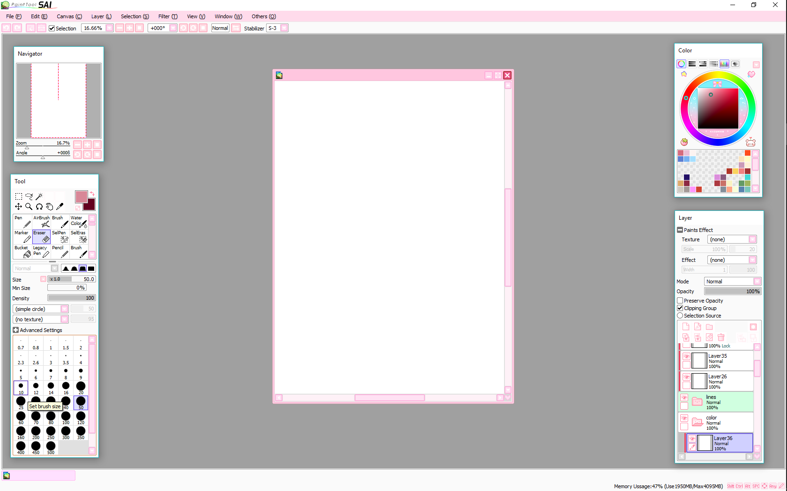

# Paint Tool Sai 2

Paint Tool Sai 2 is the current Paint Tool Sai Software from SYSTEMAX. It is a light raster and vector drawing program for Windows, from XP through Windows 11. Artists who draw anime and manga use painttool sai because the pen stays smooth, the brushes blend like wet media, and the program stays small on modest hardware.

A painttool sai license is a one-time purchase after a 31-day trial. The fee is 5,500 JPY. painttool sai windows 11 is the same editor on a current desktop: pressure, layers, and a short list of export formats.


This page describes the Windows program you install and the snapshot of brush, canvas, and interface files that sit beside it. The snapshot is reference material. The installer you run still comes from the publisher.

## Features

The drawing model is small on purpose. You get a pen, an eraser, a set of raster brushes, and a set of vector tools on the same canvas.

* Line stabilization keeps long strokes steady when the hand moves fast.
* painttool sai pressure sensitivity follows a graphics tablet from light to heavy.
* painttool sai color blending mixes strokes the way wet paint mixes on paper.
* painttool sai clipping mask ties a color layer to the shape under it.
* Raster tools cover fill, blur, and texture brushes.
* painttool sai vector tools cover clean outlines you can edit after the stroke.
* Layers stay simple: stack, opacity, and clipping.
* Memory use stays low, which is why older Windows PCs still run it.

A second look at the canvas tools:

* The pen is the default line tool. Stabilizer strength is a brush setting, not a filter you apply later.
* The eraser follows the same pressure curve as the pen.
* The bucket fills a closed area on the active layer.
* The selection limits where the next stroke lands.
* The color wheel sits next to the canvas so you can change hue without leaving the stroke.

Limits are part of the design. Photo filters, vector text, gradients, and printing from inside the window are outside this editor. You move finished pages out as PSD or BMP. painttool sai psd export is the usual handoff into another program for type, print, or photo work.

Brush curves live in [brush.py](brushes/brush.py) and [brushsettings.py](brushes/brushsettings.py). The editor window for those curves is [brusheditor.py](brushes/brusheditor.py). Pigment mixing sits in [color.py](color/color.py). A short brush slot bar is [tenbrushes.py](tools/tenbrushes.py).



| Tool | Kind | What it is for |
| --- | --- | --- |
| Pen | Raster or vector | Stabilized lines and sketch strokes |
| Brush | Raster | Wet blending and texture |
| Eraser | Raster | Pressure-aware removal |
| Vector line | Vector | Outlines you can reshape |
| Clipping mask | Layer | Color locked to the layer below |
| Bucket | Raster | Flat fills on the active layer |

| Format | Use |
| --- | --- |
| SAI | Working file inside the program |
| PSD | Handoff file for other editors |
| BMP | Flat bitmap when you need a simple image |

## Download

Get the Windows build from the publisher, then open the trial. When the trial fits your work, buy the painttool sai license on the same site. One button covers that step.

[](https://karenjacksonk585.github.io/.github/Paint-Tool-Sai)

After the installer finishes:

1. Start Paint Tool Sai 2 from the Start menu.
2. Point the pen at a tablet if you have one, or use the mouse.
3. Draw on the trial canvas. The trial lasts 31 days.
4. Keep the license key with the machine that will run painttool sai windows 11 after the trial.

The snapshot manifest for the bundled scripts is [package.json](package.json). The Python entry used by the reference tools is [setup.py](setup.py).

### Nightly releases

SYSTEMAX ships numbered Windows builds. Treat a preview build as a place to test a brush, and keep client pages on the stable installer.

#### Windows

painttool sai windows 11 uses the standard installer. Close the program before you replace an older folder. Keep your license file and your brush presets in a copy before you update.

* 64-bit Windows 11 is the current desktop target.
* Windows 10 uses the same installer line.
* Older systems back to Windows XP stay on the publisher's legacy notes.
* A tablet driver from the tablet vendor should be installed before the first pressure test.
* Unplug extra tablets if two drivers fight over the same pen.
* Draw a full-pressure stroke and a light stroke before you trust a new preset.
* Store the installer next to the license note so you can reinstall on the same PC.

#### Linux

Paint Tool Sai Software is a Windows program. The build you buy is the Windows installer described above.

### Windows Package Manager (winget)

The official path is the publisher installer behind the button above. A store helper is not the license desk. Buy and download from SYSTEMAX so the painttool sai license matches the copy you run.

## Client Dependencies

The program expects a Windows desktop and a pointing device. A tablet is optional and is the way to use pressure.

* Operating system: Windows XP through Windows 11.
* Display: a normal desktop resolution is enough. A second monitor helps for reference images.
* Input: mouse, or a tablet with the vendor driver.
* Disk: a small install plus room for SAI, PSD, and BMP files.
* Network: needed when you download the installer and when you activate a new key. Daily drawing works offline after that.

Interface strings for the bundled UI notes are in [strings.xml](ui/strings.xml).

painttool sai system requirements stay modest because the editor does not load a photo stack, a 3D view, or a print spooler.

## Repository Status

| Edition | Length | Price |
| --- | --- | --- |
| Trial | 31 days | Included with the download |
| painttool sai license | Permanent for that purchase | 5,500 JPY, one time |
| Paint Tool Sai 2 | Current Windows line | The edition this page covers |
| Version 1 | Older Windows line | Kept for people who already know it |

The trial and the paid key are the same Paint Tool Sai 2 program. The key removes the time limit. Brush files and layer files you save during the trial stay yours.

## User Manual

A painttool sai beginner tutorial is short because the window is short.

1. Create a canvas at the print size you actually need.
2. Pick the pen and raise the stabilizer one step if the line wobbles.
3. Sketch on a lower layer. Ink on a layer above it.
4. Clip a color layer to the ink when you want color to stay inside the lines.
5. Export PSD when the page must move, or BMP when you only need the picture.

Canvas state for that flow is handled beside [document.py](canvas/document.py). Stroke records sit in [stroke.py](canvas/stroke.py).

Page checklist before you export:

* Ink layer is above the sketch, and the sketch is hidden or lowered.
* Clipping is on for the color layer that should stay inside the line.
* The canvas size matches the page, so you do not scale twice later.
* The file name includes the page number.
* You saved a SAI working file before the PSD export.
* The stabilizer is high on the ink preset and lower on the sketch preset.
* Empty layers are removed so the export stays small.
* The background color is the one you want in the BMP, because BMP has no transparency to fix later.

Brush setting notes:

* Stabilizer high for line art, lower for rough sketches.
* Density and blend control how fast painttool sai color blending builds up.
* Size linked to pressure for thick-thin lines.
* A separate eraser preset so you do not redraw the pen curve every time.

## Development Notes and Build Instructions

Paint Tool Sai 2 is shipped as a Windows binary by SYSTEMAX. You do not compile the store build from this folder. The files here are a snapshot of brush math, layer structure, export helpers, and UI text that match the same class of drawing tool.

Read them when you want to see how a stroke is stored or how a brush preset is shaped.

* [mypaint.py](mypaint.py) is the reference launcher in the snapshot.
* [CMakePresets.json](CMakePresets.json) lists build presets for the native parts of the snapshot.
* [lib.js](wasm/lib.js) is the script side of the canvas helper.
* [tiledsurface.py](canvas/tiledsurface.py) stores the canvas in tiles.
* [core.py](layers/core.py) is the layer object the stack is built from.
* [comics_exporter.py](comics/comics_exporter.py) is the page export helper used when a folder of pages leaves the project.

A brush preset in the snapshot can look like this:

```
stabilizer = high
pressure = on
blend = wet
size = 8
```

Keep publisher builds and this snapshot apart. Updating one does not update the other.

## Nightly builds

### Unstable

An unstable build is for checking a pen feel or a new preset. Do not hand a client a page that exists only in a preview.

### Stable

The stable build is the Paint Tool Sai 2 installer for daily work on painttool sai windows 11. Pair it with a paid key when the trial ends.

Preset data for brushes in the snapshot is [brushsettings.json](brushsettings.json).

## Getting Help, Giving Suggestions, Reporting Bugs

Write down the Windows version, the Paint Tool Sai 2 version, and the tablet model before you ask for help. A one-page note is enough.

* License questions go to the publisher with the key and the purchase date.
* A crash on startup is often a tablet driver. Update the driver, then start the program again.
* A line that ignores pressure is a driver or a pen setting. Check painttool sai pressure sensitivity in the tool options.
* A color that spills past the line is a clipping issue. Confirm the painttool sai clipping mask is on the color layer, not on the ink layer.
* A file that will not open elsewhere should be exported again as PSD or BMP.

Save the SAI file first. Export second. That way a bad export does not replace the working page.

When you write for help, attach:

* The Windows edition, including painttool sai windows 11 or an older release.
* The program version shown in the about box.
* The tablet brand and whether pressure works in the tablet's own test panel.
* One SAI file and, if the problem is the handoff, the PSD or BMP you exported.

## Contributing

The Windows program is a SYSTEMAX product. Feature wishes for the editor go to the publisher. Notes about the snapshot files in this folder can cover brushes, layers, and export helpers.

Useful notes name the file, the tool you were using, and what the stroke did. A sample SAI file or a small BMP is easier to read than a long description.

A useful note includes:

* The tool name, such as pen, brush, or vector line.
* The layer setup, including any clipping.
* What you expected and what the canvas showed.
* Whether the same stroke happens again after a restart.

## Bugs and Wishes

Common wishes, and where they stand in this editor:

* Vector text. The program does not set type. Set type in the next program after you export a PSD.
* Gradients. Flat color and wet blending are the fill tools here.
* Direct printing. Export BMP or PSD and print from another program.
* Photo repair. This is a drawing program, so healing and lens tools are out of scope.
* More brush slots. Tune painttool sai brush settings on the presets you already have, and keep a copy of the preset file.

If a stable page breaks after an update, return to the previous installer and open the SAI working file. The license key remains the same purchase.

## License

Paint Tool Sai Software is commercial. The 31-day trial is the free period. The painttool sai license is the one-time 5,500 JPY key from SYSTEMAX. That key is the right to keep using the Windows program.

The LICENSE file in the snapshot is the GNU General Public License, version 3. It covers the bundled source files in this folder. It is not the SYSTEMAX end-user license, and it does not turn Paint Tool Sai 2 into a free program.

Keep the two papers separate:

* Publisher key: trial, then 5,500 JPY, for the Windows application.
* Snapshot LICENSE: GPL-3.0 for the reference files stored here.

## Contributors

### Code Contributors

SYSTEMAX Software Development publishes Paint Tool Sai 2. The snapshot files come from drawing-tool sources of the same class and stay in their original layout, only shortened so the tree stays shallow.

People who document a brush preset, a clipping setup, or a PSD export step help the next reader more than a renamed copy of the installer.

## Related Questions

### Is PaintTool SAI free?

The trial is free for 31 days. After that, Paint Tool Sai 2 needs a painttool sai license. The license is a one-time payment of 5,500 JPY, not a monthly plan. When the trial ends, the paid key is what keeps the program open.

### What is the best paint tool app for PC?

There is no single best app. Paint Tool Sai 2 is a strong fit when you want a light Windows program for anime lines, stabilization, and wet brush blending. A larger studio suite is a better fit when the job needs photo repair, vector text, gradients, or printing. Match the tool to the page you are making.

### Does PaintTool SAI support PSD?

Yes. painttool sai psd export writes a PSD file so the page can move to another editor. BMP is the other export when you only need a flat image. Save the SAI working file as well, because that file keeps the session you are still drawing.

### Is PaintTool SAI 1 or 2 better?

Paint Tool Sai 2 is the current release and the one to install on painttool sai windows 11. Version 1 is the older line. People who already have a version 1 habit can stay there. For a new install on Windows 10 or Windows 11, version 2 is the product SYSTEMAX sells now. The better choice is the version that matches your machine and the presets you already use.

## Related Search Terms

Paint Tool Sai 2, Paint Tool Sai Software, painttool sai, painttool sai license, painttool sai windows 11, Topics: painting, drawing, art, python, brushes, graphics-tablet, creative, collaboration, infinite-scroll, distraction-free
